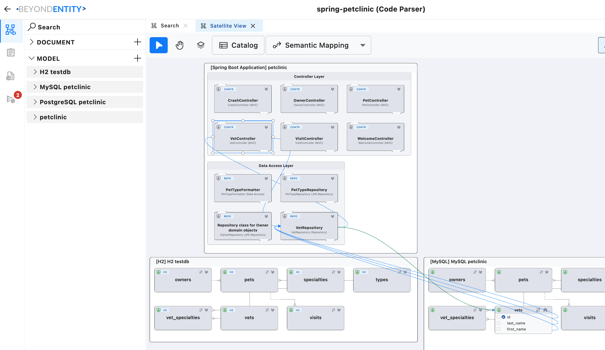
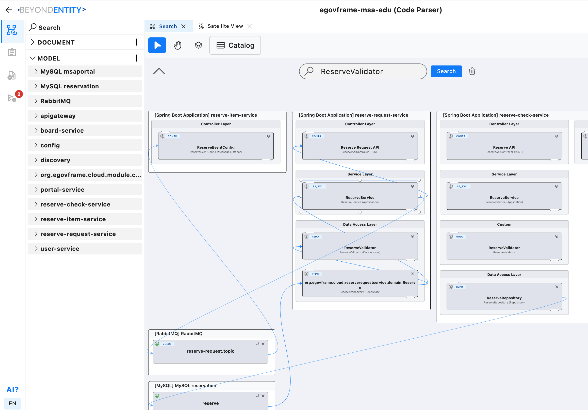
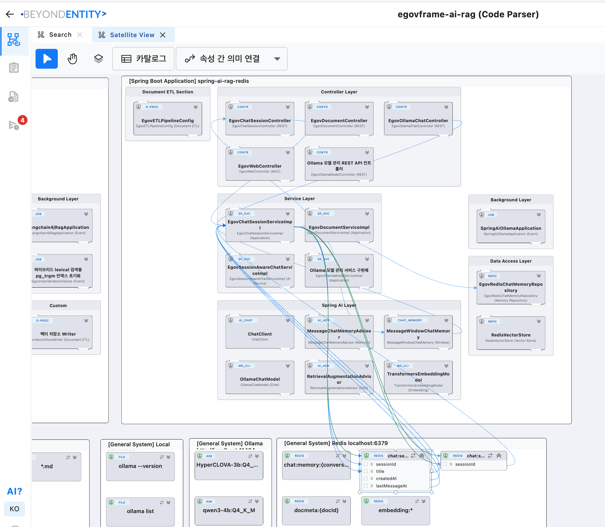
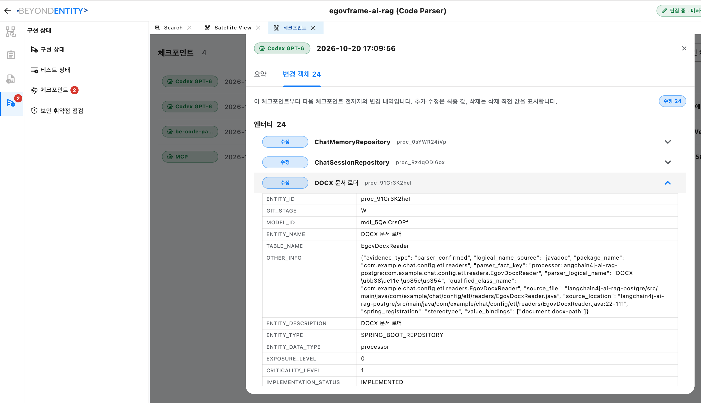
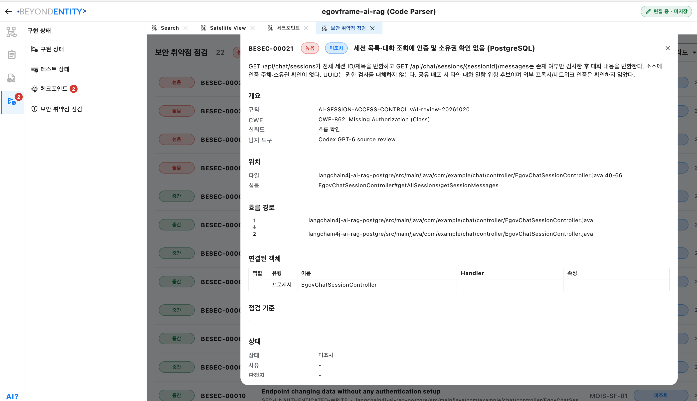
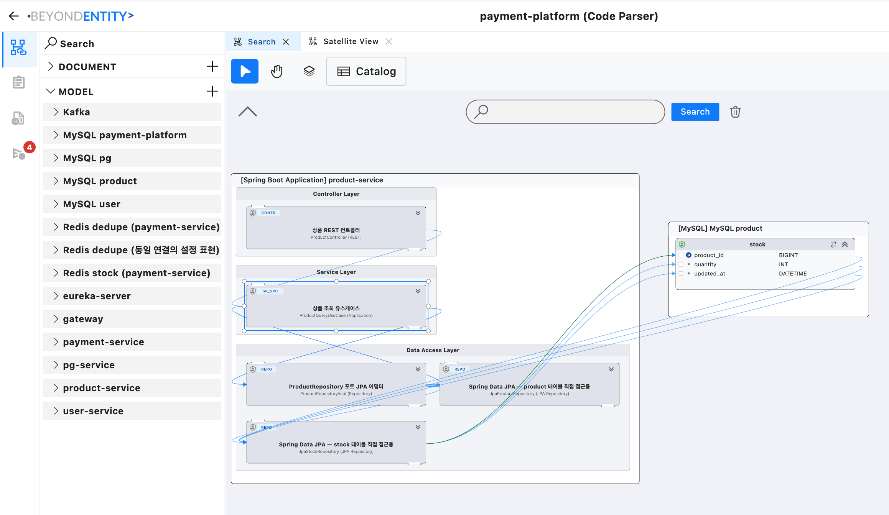
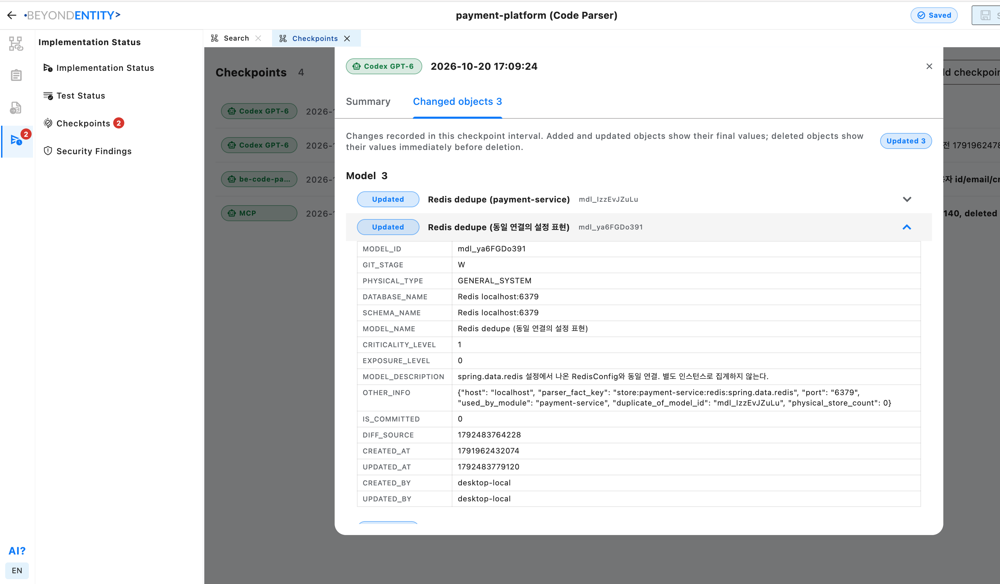
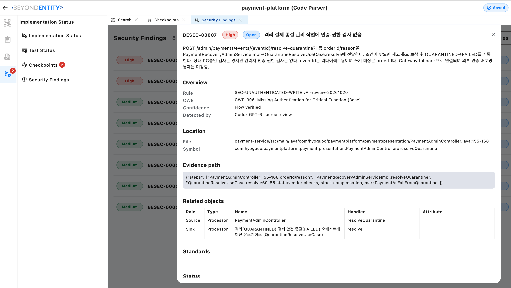

# Spring Boot and eGovFrame architecture samples

Beyond Entity now represents framework responsibilities explicitly, including **Controller Layer**, **Service Layer**, and **Data Access Layer**. These samples show Java/Spring code as application modules, processors, transformations, data stores, and attribute-level lineage, so engineers and AI coding agents can inspect the structure and follow data through it.

[Open the sample project catalog](https://beyondentity.com/en/sample-projects) to select a sample, explore it in the Web Viewer without installing the desktop app, or download its `.bemdl` project for Beyond Entity. This directory contains guides and screenshots; the model downloads are available from the catalog.

## What the framework views show

- **Controller Layer:** MVC/REST entry points and message listeners.
- **Service Layer:** application services and use cases that coordinate processing.
- **Data Access Layer:** repositories, DAO/Mapper responsibilities, and access to persistent or other stored data.
- **Data lineage:** connections from processing inputs and outputs to DB, file, memory, and other modeled resources. Expand selected boxes to inspect attributes and mappings.
- **Spring AI components:** AI clients, advisors, chat memory, embedding models, and vector stores alongside the surrounding application and storage layers.

The layers describe the extracted code. A project need not contain every layer: the Petclinic view below, for example, shows controllers and data access without an intervening Service Layer.

## Four sample projects

| Sample | What to explore | Preparation |
| --- | --- | --- |
| **spring-petclinic** | Spring Boot MVC controllers, repositories, and lineage to H2, MySQL, and PostgreSQL models. | Code Parser |
| **egovframe-msa-edu** | eGovFrame microservices, controller/service/data access boundaries, and RabbitMQ message flows. | Code Parser |
| **egovframe-ai-rag** | eGovFrame AI/RAG applications, Spring AI components, Redis/PostgreSQL storage, and AI call flows. | Code Parser + AI review and false-positive correction |
| **payment-platform** | Spring payment microservices, application use cases, JPA repositories, and database/storage dependencies. | Code Parser + AI review and false-positive correction |

All four started with Code Parser extraction of architecture, data lineage, and security pre-check findings. For **egovframe-ai-rag** and **payment-platform**, AI subsequently reviewed the extracted results and corrected false positives; inspect their **Checkpoints** for the recorded corrections.

### Spring Petclinic

Explore the MVC controllers and repositories in the Spring Boot application, then follow their connections to database entities. The diagram preserves the structure found in the code.

### eGovFrame MSA education

Compare responsibilities across reservation services and follow the message flow through RabbitMQ. The view brings service boundaries, processing layers, and storage dependencies into the same architecture.

### eGovFrame AI/RAG

Inspect controllers and services alongside chat clients, advisors, chat memory, embedding models, vector stores, and Redis data. Expand relevant inputs and outputs to examine the modeled AI request/response flow.

Checkpoints retain the reviewed changes and object details, providing context for the next engineer or AI agent.

Security findings include severity, status, rule/CWE information, source location, evidence paths, and related architecture objects. This example records an authorization concern around session listing and conversation retrieval.

### Payment platform

Follow the product controller through its application use case and repository adapters to database attributes.

The checkpoint illustrates a correction that identifies two configuration representations as the same Redis connection, avoiding a separate physical-store count.

Review an administrative payment operation with its source-to-use-case evidence path and related processors.

## Use the architecture during development and review

1. Establish or review the intended architecture, including entities, attributes, processors, and transformations.
2. Extract the current implementation with [Code Parser](../../spring_code_parser/README.md), then review source-backed facts and unresolved details.
3. Ask an AI coding agent to read the current design through MCP before implementing changes and synchronize verified architectural changes afterward.
4. Inspect implementation/test status and Checkpoints; use Architecture Diff at PR or milestone reviews to focus source review on structural changes.
5. Review security findings and data flows as supporting evidence for security assessment.

Security findings are a **pre-check**, not a final security verdict. Parser output and AI corrections require review against the source and deployment context. Screenshots capture sample states; use the online projects for the available model versions.

[All samples](../README.md) · [Sample project catalog](https://beyondentity.com/en/sample-projects) · [Installation guide](../../INSTALL.md)
